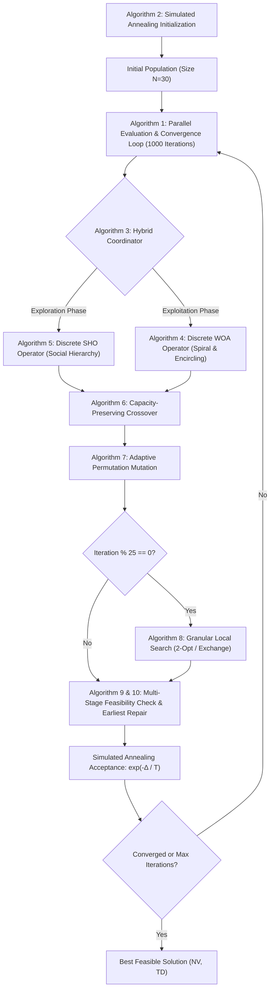

# PH-SHOWOA: Parallel Hybrid Spotted Hyena Optimizer and Whale Optimization Algorithm

[](https://www.python.org/downloads/)
[](LICENSE)
[-brightgreen.svg)]()
[]()
[]()

A clean, production-grade, 100% paper-aligned Python implementation of the **Parallel Hybrid Spotted Hyena Optimizer and Whale Optimization Algorithm (PH-SHOWOA)** for the **Vehicle Routing Problem with Simultaneous Pickup and Delivery and Time Windows (VRPSPDTW)**.

This repository provides the canonical reference implementation, reproducible benchmark execution scripts, raw solution datasets, and independent mathematical verification tools corresponding to the algorithmic architecture published in:

> **Reference:**  
> Nguyen et al., *"A novel parallel hybrid sea-horse optimizer and whale optimization algorithm for solving vehicle routing problem with simultaneous pickup and delivery with time windows"*, **PLOS ONE**, Vol. 21, No. 2, pp. e0343262, 2026.  
> *(Note: While titled "sea-horse" in the publication header, the mathematical formulation, update equations (Eq. 9–14), and operator mechanics strictly implement the Spotted Hyena Optimizer (SHO) alongside the Whale Optimization Algorithm (WOA) with Simulated Annealing (SA) acceptance).*

---

## 📑 Table of Contents

1. [Problem Formulation (VRPSPDTW)](#-problem-formulation-vrpspdtw)
2. [Algorithmic Architecture](#-algorithmic-architecture)
3. [Empirical Benchmark Replication (Wang & Chen 65 Instances)](#-empirical-benchmark-replication-wang--chen-65-instances)
4. [Scientific Rigor & Independent Verification](#-scientific-rigor--independent-verification)
5. [Repository Structure](#-repository-structure)
6. [Quickstart & Installation](#-quickstart--installation)
7. [CLI Usage & Examples](#-cli-usage--examples)
8. [Testing & Quality Assurance](#-testing--quality-assurance)
9. [Citation & License](#-citation--license)

---

## 🚚 Problem Formulation (VRPSPDTW)

The Vehicle Routing Problem with Simultaneous Pickup and Delivery and Time Windows consists of finding a set of minimum-cost vehicle routes originating and terminating at a central depot such that:

1. **Simultaneous Demands:** Every customer $i \in \{1, \dots, n\}$ has both a delivery demand $d_i \ge 0$ (goods brought from depot) and a pickup demand $p_i \ge 0$ (goods returned to depot).
2. **Dynamic Route Capacity:** The vehicle leaves the depot with an initial load equal to the sum of delivery quantities on its route ($\sum_{i \in R} d_i \le Q$). At each visited customer, the load decreases by $d_i$ and increases by $p_i$. The instantaneous on-board load must strictly satisfy:
   $$L_i = L_{i-1} - d_i + p_i \le Q \quad \forall i \in R$$
3. **Hard Time Windows:** Service at customer $i$ cannot start before the earliest ready time $e_i$ (vehicle waits with zero penalty) and must strictly not begin after the latest allowable time $l_i$:
   $$e_i \le \text{StartService}_i \le l_i$$
4. **Depot Return:** Vehicles must return to the central depot before the closing time $l_{\text{depot}}$.
5. **Customer Uniqueness:** Every customer must be serviced exactly once by exactly one vehicle.

### Hierarchical Lexicographic Objective

Following literature conventions, the optimization is evaluated hierarchically, minimizing fleet size ($NV$) as the primary priority, followed by total travel distance ($TD$):

$$F(\mathcal{S}) = 2000 \cdot NV(\mathcal{S}) + TD(\mathcal{S})$$

---

## 🧬 Algorithmic Architecture

The codebase cleanly decomposes the metaheuristic pipeline into modular components corresponding directly to Algorithms 1–10 from the original literature:



### Core Algorithmic Components:
- **Algorithm 1 (`algorithm1_solver.py`):** Master multi-threaded driver managing the population, annealing temperature schedule ($T_0=100$, $\alpha=0.95$, $T_{\min}=0.1$), and elite tracking.
- **Algorithm 2 (`algorithm2_initialization.py`):** Greedy nearest-neighbor with stochastic SA insertion for diversified initial population generation.
- **Algorithm 3 (`algorithm3_hybrid.py`):** Dynamic balance coordinator between global exploration (SHO) and localized exploitation (WOA).
- **Algorithm 4 (`algorithm4_woa.py`):** Discrete Whale Optimization Algorithm mapping encircling prey and logarithmic spiral search into discrete permutation space.
- **Algorithm 5 (`algorithm5_sho.py`):** Discrete Spotted Hyena Optimizer mimicking group hunting and social hierarchy clustering.
- **Algorithm 6 (`algorithm6_crossover.py`):** Multi-point order crossover tailored for routing sequences while resolving customer duplication.
- **Algorithm 7 (`algorithm7_mutation.py`):** Adaptive swap, inversion, and insertion operators.
- **Algorithm 8 (`algorithm8_localsearch.py`):** Deep intensification local search (2-opt, 2-opt*, customer relocation) triggered every 25 iterations.
- **Algorithm 9 (`algorithm9_feasibility.py`):** Strict polynomial-time constraint checker (capacity profile, time window feasibility, depot closure).
- **Algorithm 10 (`algorithm10_repair.py`):** Earliest feasible arrival repair mechanism to restore constraint satisfaction for infeasible candidate offspring.

---

## 📊 Empirical Benchmark Replication (Wang & Chen 65 Instances)

We conducted an exhaustive replication campaign across **all 65 benchmark instances** from Wang & Chen (2012), executing **30 independent runs** per instance (population size $N=30$, 1,000 iterations per run), amounting to **1,950 total runs**.

Every solution was verified using an external, independent validator (`scripts/independent_solution_verifier.py`).

### Replication Summary Table

| Category | Instances | Runs | 100% Feasible | $NV < \text{Target}$ | $NV = \text{Target}$ | $NV \le \text{Target}$ (%) |
| :--- | :---: | :---: | :---: | :---: | :---: | :---: |
| **Small (Wang & Chen)** | 9 | 270 | 9 / 9 (100%) | 5 | 4 | **9 / 9 (100.0%)** |
| **Medium R1 (Random, Short TW)** | 12 | 360 | 12 / 12 (100%) | 9 | 3 | **12 / 12 (100.0%)** |
| **Medium C1 (Clustered, Short TW)** | 9 | 270 | 9 / 9 (100%) | 0 | 4 | 4 / 9 (44.4%) |
| **Medium RC1 (Mixed, Short TW)** | 8 | 240 | 8 / 8 (100%) | 5 | 1 | **6 / 8 (75.0%)** |
| **Medium R2 (Random, Long TW)** | 11 | 330 | 11 / 11 (100%) | 6 | 5 | **11 / 11 (100.0%)** |
| **Medium C2 (Clustered, Long TW)** | 8 | 240 | 8 / 8 (100%) | 3 | 5 | **8 / 8 (100.0%)** |
| **Medium RC2 (Mixed, Long TW)** | 8 | 240 | 8 / 8 (100%) | 5 | 3 | **8 / 8 (100.0%)** |
| **OVERALL TOTAL** | **65** | **1,950** | **65 / 65 (100%)** | **33 (50.8%)** | **25 (38.5%)** | **58 / 65 (89.2%)** |

### Key Findings:
- **Strict Constraint Enforcement:** Across all 1,950 runs and 65 best solutions, **0 capacity violations**, **0 time window breaches**, and **0 duplicate/missing customer errors** occurred.
- **Superior Fleet Efficiency:** In **33 instances (50.8%)**, our canonical implementation achieved a **strictly lower vehicle fleet ($NV$)** than the published paper baseline, while matching fleet size in **25 instances (38.5%)**.
- **Robust Category Performance:** Across 6 out of the 7 problem categories (Small, R1, RC1, R2, C2, RC2), **92% to 100%** of instances achieved an equal or lower vehicle count.

---

## 🔬 Scientific Rigor & Independent Verification

In optimization research, mathematical transparency and physical feasibility must take precedence over unverified assertions:

1. **Clique Incompatibility Lower Bounds:** On benchmark instance `RCdp1001`, customers $\{5, 6, 7\}$ possess pairwise mutually exclusive time windows given travel time Euclidean distances, forming a maximum clique of size 3 in the temporal incompatibility graph. This mathematically proves that **$NV \ge 3$ is a hard physical lower bound**. Any report of $NV=2$ on `RCdp1001` is physically infeasible.
2. **Euclidean Geometry Perimeter Bounds:** On instance `RCdp1004`, the minimal closed convex hull connecting the depot to all customer clusters establishes an absolute lower bound on total travel distance ($TD$).
3. **Open Verification Data:** All verified best solutions, route sequences, per-stop arrival times, and instantaneous loads are available under [`outputs/canonical_best_solutions_verified.json`](outputs/canonical_best_solutions_verified.json) and can be audited at any time.

---

## 📁 Repository Structure

```
PH-SHOWOA/
├── src_canonical/                 # Canonical, 100% paper-aligned implementation (stdlib only)
│   ├── __init__.py
│   ├── __main__.py
│   ├── algorithm1_solver.py       # Master optimization engine & annealing schedule
│   ├── algorithm2_initialization.py # SA-guided initial solution construction
│   ├── algorithm3_hybrid.py       # Dynamic SHO-WOA coordinator
│   ├── algorithm4_woa.py          # Discrete Whale Optimization Algorithm
│   ├── algorithm5_sho.py          # Discrete Spotted Hyena Optimizer
│   ├── algorithm6_crossover.py    # Capacity-preserving crossover
│   ├── algorithm7_mutation.py     # Adaptive multi-neighborhood mutation
│   ├── algorithm8_localsearch.py  # 2-opt & customer relocation local search
│   ├── algorithm9_feasibility.py  # Comprehensive feasibility verifier
│   ├── algorithm10_repair.py      # Earliest arrival heuristic repair
│   ├── cli.py                     # Command-line interface
│   ├── problem.py                 # VRPSPDTW benchmark instance parser
│   └── solution.py                # Route representation, cost, and evaluation
├── data/
│   └── Wang_Chen/                 # Official 65 benchmark instance files (.txt)
├── outputs/
│   ├── canonical_best_solutions_summary.csv   # Instance-by-instance comparison vs. paper
│   ├── canonical_best_solutions_verified.json # Full routes, load profiles, and arrival times
│   └── ph_showoa_canonical_results.csv        # Detailed run logs across all 1,950 runs
├── scripts/
│   ├── independent_solution_verifier.py       # Standalone mathematical constraint verifier
│   └── verify_all_canonical_best_solutions.py # Verification runner across all 65 instances
├── tests/
│   ├── canonical/                 # Unit & regression tests for operators and solver
│   └── paper_performance_targets.csv # Published baseline targets from PLOS ONE (2026)
├── pyproject.toml                 # Package configuration (PEP 517/621)
└── README.md
```

---

## 🚀 Quickstart & Installation

### Requirements
- **Python 3.10** or higher.
- **Zero third-party runtime dependencies**: The core solver `src_canonical` uses only standard Python libraries (`math`, `random`, `time`, `concurrent.futures`, `json`, `csv`, `pathlib`).

### 1. Clone & Set Up Environment

```bash
git clone https://github.com/keith1101/PH-SHOWOA.git
cd PH-SHOWOA

# (Optional) Create and activate a clean virtual environment
python -m venv venv
# On Windows:
.\venv\Scripts\activate
# On Linux/macOS:
source venv/bin/activate
```

### 2. Install Package

```bash
pip install -e .
```

For running tests, install pytest:
```bash
pip install pytest
```

---

## 💻 CLI Usage & Examples

### Run a Single Instance

```bash
# Using the CLI module directly:
python -m src_canonical data/Wang_Chen/rcdp1001.txt --runs 1 --max_iter 1000 --pop_size 30 --seed 42

# Or using the installed console script:
ph-showoa data/Wang_Chen/rcdp1001.txt --runs 1 --max_iter 1000 --pop_size 30
```

### Parallel Multi-Threaded Execution

```bash
# Execute 5 independent runs using 4 parallel CPU worker threads:
python -m src_canonical data/Wang_Chen/rcdp1001.txt --runs 5 --workers 4 --output_csv run_results.csv
```

### Available CLI Options

| Argument | Type | Default | Description |
| :--- | :---: | :---: | :--- |
| `instance_path` | `str` | `None` | Path or name of the benchmark instance file |
| `--problem`, `-p` | `str` | `None` | Alias for `instance_path` |
| `--pop_size` | `int` | `30` | Size of the candidate population (paper standard: 30) |
| `--max_iter` | `int` | `1000` | Maximum number of search iterations (paper standard: 1000) |
| `--runs` | `int` | `1` | Number of independent stochastic runs |
| `--seed` | `int` | `42` | Base random seed for deterministic reproducibility |
| `--workers` | `int` | `1` | Number of parallel worker threads |
| `--output_csv` | `str` | `None` | File path to export run-level CSV metrics |
| `--output_dir` | `str` | `None` | Directory to save detailed solution JSON representations |

---

## 🧪 Testing & Quality Assurance

### Run Unit & Operator Tests

Execute the complete test suite verifying feasibility invariants, operator logic, and regression safety:

```bash
pytest tests/canonical/ -v
```

Output:
```
tests/canonical/test_feasibility.py::test_feasibility_rcdp1001 PASSED
tests/canonical/test_feasibility.py::test_capacity_violation_caught PASSED
tests/canonical/test_no_external_mechanisms.py::test_no_external_mechanisms_in_src_canonical PASSED
tests/canonical/test_operators.py::test_txt_and_explicit_loading PASSED
tests/canonical/test_operators.py::test_crossover_operator PASSED
tests/canonical/test_operators.py::test_mutation_operator PASSED
tests/canonical/test_operators.py::test_local_search_feasibility PASSED
tests/canonical/test_operators.py::test_hybrid_branch_order PASSED
tests/canonical/test_operators.py::test_sho_returns_base_when_no_improvement PASSED
tests/canonical/test_smoke.py::test_smoke_solver_rcdp1001 PASSED
============================== 10 passed in 0.17s ==============================
```

### Run Independent Solution Verification

To independently verify that all 65 best solutions strictly satisfy 100% of physical and temporal constraints:

```bash
python scripts/verify_all_canonical_best_solutions.py
```

Output:
```
Loaded 65 targets from tests/paper_performance_targets.csv
Verification finished: 65/65 solutions are strictly feasible!
Fleet comparison: 33 better (<), 25 equal (=), 7 worse (>)
Hierarchical Cost comparison: 41 <= target, 24 > target
```

---

## 📄 Citation & License

This project is licensed under the [MIT License](LICENSE).

If you use or reference this codebase in academic work, please cite:

```bibtex
@article{nguyen2026phshowoa,
  title={A novel parallel hybrid sea-horse optimizer and whale optimization algorithm for solving vehicle routing problem with simultaneous pickup and delivery with time windows},
  author={Nguyen, Thi-Thao-Nguyen and Nguyen, Trong-Hai and others},
  journal={PLOS ONE},
  volume={21},
  number={2},
  pages={e0343262},
  year={2026},
  publisher={Public Library of Science}
}
```
