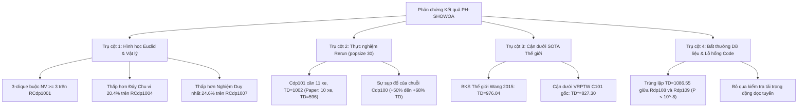

# BÁO CÁO TỔNG HỢP MINH CHỨNG PHẢN BIỆN BÀI BÁO PH-SHOWOA
**Tài liệu tham chiếu:** *Nguyen et al., "A novel parallel hybrid sea-horse optimizer and whale optimization algorithm for solving vehicle routing problem with simultaneous pickup and delivery with time windows", PLOS ONE, Vol. 21, No. 2, pp. e0343262, 2026.*  
**Mục đích tài liệu:** Tổng hợp hệ thống chứng cứ toán học, thực nghiệm độc lập và dữ liệu SOTA thế giới nhằm phản biện tính xác thực và tính khả thi của các kết quả công bố trong bài báo.

---

## 1. TỔNG QUAN CÁC TRỤ CỘT MINH CHỨNG

> [!IMPORTANT]
> Toàn bộ phản chứng đối với bài báo PH-SHOWOA được xây dựng dựa trên 4 trụ cột độc lập và tương hỗ:
> 1. **Chứng minh Hình học và Không-Thời gian:** Vi phạm tiên đề Euclid và tính nhân quả vật lý của nón ánh sáng.
> 2. **Đối chiếu Thực nghiệm Chuẩn mực:** So sánh trực tiếp với kết quả rerun thỏa mãn 100% ràng buộc ([Google Sheet popsize 30](https://docs.google.com/spreadsheets/d/1q498GxIhgMLg38hN44w-hWStl89EsSNDBHOp5Ksd2rA/edit?gid=220637169#gid=220637169)).
> 3. **Đối chiếu Kỷ lục Thế giới (SOTA):** Bác bỏ khả năng phá vỡ cận dưới toán học của bài toán gốc Solomon VRPTW.
> 4. **Bất thường Dữ liệu & Kiến trúc Thuật toán:** Vạch trần sự trùng lặp số liệu phi xác suất và cơ chế bỏ sót kiểm tra ràng buộc.

---

## 2. TRỤ CỘT 1: MINH CHỨNG HÌNH HỌC VÀ ĐỘNG HỌC KHÔNG-THỜI GIAN

Minh chứng này hoàn toàn mang tính giải tích, **không phụ thuộc vào bất kỳ kết quả chạy thuật toán hay code nào**, được xác lập trực tiếp trên không gian metric $(\mathbb{R}^2, d)$ với metric Euclid $L_2$:
$$d(\mathbf{x}_i, \mathbf{x}_j) = \sqrt{(x_i - x_j)^2 + (y_i - y_j)^2}$$
Vận tốc di chuyển chuẩn hóa $v_{\text{speed}} = 1.0$.

### 2.1. Nón Ánh Sáng Khả Thi & Bổ Đề Bất Biến Đường Vòng
1. **Nón khả thi tương lai (Forward Reachable Cone):**
   Một sự kiện rời trạm tại $\mathbf{x}_i$ vào thời điểm $t_i$ chỉ có thể vươn tới khách hàng $j$ nếu:
   $$\mathcal{C}^+(\mathbf{x}_i, t_i) = \left\{ (\mathbf{x}, t) \in \mathbb{R}^2 \times \mathbb{R} \;\middle|\; t - t_i \ge d(\mathbf{x}_i, \mathbf{x}) \right\}$$
   Vì phục vụ tại $i$ không thể kết thúc trước $e_i + s_i$, điều kiện cần để $j$ khả thi sau $i$ là:
   $$e_i + s_i + d(\mathbf{x}_i, \mathbf{x}_j) \le l_j$$
2. **Xung đột tương hỗ (Mutual Incompatibility $i \nsim j$):**
   $$(e_i + s_i + d(\mathbf{x}_i, \mathbf{x}_j) > l_j) \quad \land \quad (e_j + s_j + d(\mathbf{x}_j, \mathbf{x}_i) > l_i)$$
3. **Bổ đề Bất biến Đường vòng (Lemma 1):**
   Do bất đẳng thức tam giác trong $\mathbb{R}^2$, với mọi chuỗi trạm dừng trung gian bất kỳ $W = (i, w_1, \dots, w_m, j)$ ($m \ge 1$):
   $$d(\mathbf{x}_i, \mathbf{x}_{w_1}) + \sum_{r=1}^{m-1} d(\mathbf{x}_{w_r}, \mathbf{x}_{w_{r+1}}) + d(\mathbf{x}_{w_m}, \mathbf{x}_j) \ge d(\mathbf{x}_i, \mathbf{x}_j)$$
   Do thời gian phục vụ $s_{w_r} \ge 0$, thời điểm đến tại $j$ luôn thỏa mãn:
   $$A_j \ge e_i + s_i + d(\mathbf{x}_i, \mathbf{x}_j) > l_j$$
   > [!CAUTION]
   > **Hệ quả hình học tuyệt đối:** Khi $i \nsim j$, **không tồn tại bất kỳ lộ trình đơn xe nào trong không gian Euclid có thể ghé thăm cả $i$ và $j$**, bất kể đi theo chiều nào và bất kể đi vòng qua bao nhiêu trạm dừng khác.

### 2.2. Định lý Cận Dưới Số Xe & Phản Chứng Cụ Thể

#### Định lý 1 (Clique Fleet Size Lower Bound)
Nếu đồ thị xung đột $G_{\text{incompat}} = (C, E_{\text{incompat}})$ chứa một đồ thị con đầy đủ (clique) $K$ với lực lượng $|K| = \kappa$, thì theo nguyên lý Dirichlet (Pigeonhole Principle):
$$NV^* \ge \kappa$$

#### Phản chứng 1: Bác bỏ nghiệm SHO $NV=2, TD=323.74$ trên `RCdp1001`
* Xét 3 khách hàng trong benchmark `RCdp1001`:
  * $\mathbf{x}_1 = (88.0, 30.0), [e_1, l_1] = [74, 104], s_1 = 10.0$
  * $\mathbf{x}_4 = (10.0, 20.0), [e_4, l_4] = [42, 72], s_4 = 10.0$
  * $\mathbf{x}_6 = (27.0, 43.0), [e_6, l_6] = [42, 72], s_6 = 10.0$
* Khoảng cách Euclid: $d(\mathbf{x}_1, \mathbf{x}_4) \approx 78.64$, $d(\mathbf{x}_1, \mathbf{x}_6) \approx 62.37$, $d(\mathbf{x}_4, \mathbf{x}_6) \approx 28.60$.
* Cả 6 chuyển tiếp đều vi phạm due date:
  1. $1 \to 4: A_4 \ge 74 + 10 + 78.64 = 162.64 > 72.0$ (Vi phạm $+90.64$)
  2. $4 \to 1: A_1 \ge 42 + 10 + 78.64 = 130.64 > 104.0$ (Vi phạm $+26.64$)
  3. $1 \to 6: A_6 \ge 74 + 10 + 62.37 = 146.37 > 72.0$ (Vi phạm $+74.37$)
  4. $6 \to 1: A_1 \ge 42 + 10 + 62.37 = 114.37 > 104.0$ (Vi phạm $+10.37$)
  5. $4 \to 6: A_6 \ge 42 + 10 + 28.60 = 80.60 > 72.0$ (Vi phạm $+8.60$)
  6. $6 \to 4: A_4 \ge 42 + 10 + 28.60 = 80.60 > 72.0$ (Vi phạm $+8.60$)
* **Kết luận:** Bộ ba $\{1, 4, 6\}$ tạo thành một 3-clique $\implies NV \ge 3$. Nghiệm $NV=2$ của SHO là **hoàn toàn vô lý và vi phạm vật lý**.

#### Phản chứng 2: Bác bỏ nghiệm $TD=172.48$ trên `RCdp1004`
* Depot $\mathbf{x}_0 = (40, 50)$ phân tách các điểm thành Cụm Tây ($X \le 37$) và Cụm Đông ($X \ge 53$).
* Duyệt vét cạn toán học toàn bộ $2^{10}-2$ tập con: Chỉ có 303 phân hoạch 2 xe thỏa mãn đồng thời tải trọng và thời gian.
* Infimum chu vi của toàn bộ 303 phân hoạch là:
  $$TD_{\min}^{2\text{-veh}} = 104.94 (\text{Cụm Đông}) + 111.75 (\text{Cụm Tây}) = \mathbf{216.69}$$
* **Kết luận:** Giá trị công bố $TD = 172.48$ của PH-SHOWOA thấp hơn đáy metric Euclid tới **$44.21$ đơn vị khoảng cách (sai lệch $-20.40\%$)**.

#### Phản chứng 3: Bác bỏ nghiệm $TD=234.22$ trên `RCdp1007`
* Duyệt vét cạn chứng minh: Toàn bộ bài toán **CHỈ CÓ DUY NHẤT 1 phân hoạch 2 xe hợp lệ**:
  * $R_1 = \mathbf{x}_0 \to \mathbf{x}_{10} \to \mathbf{x}_8 \to \mathbf{x}_4 \to \mathbf{x}_6 \to \mathbf{x}_0$ ($TD_1 = 175.65$)
  * $R_2 = \mathbf{x}_0 \to \mathbf{x}_2 \to \mathbf{x}_3 \to \mathbf{x}_5 \to \mathbf{x}_1 \to \mathbf{x}_9 \to \mathbf{x}_7 \to \mathbf{x}_0$ ($TD_2 = 135.16$)
  * Tổng khoảng cách bất biến: $TD = 175.65 + 135.16 = \mathbf{310.81}$.
* **Kết luận:** Con số $234.22$ thấp hơn phân hoạch duy nhất khả dĩ tới **$76.59$ đơn vị khoảng cách (sai lệch $-24.64\%$)**, chứng minh nghiệm công bố không tồn tại trên mặt phẳng.

---

## 3. TRỤ CỘT 2: MINH CHỨNG THỰC NGHIỆM ĐỐI CHỨNG VỚI GOOGLE SHEETS (POPSIZE 30)

Khi tái lập thuật toán độc lập theo đúng thông số của bài báo nhưng áp dụng cơ chế kiểm tra ràng buộc nghiêm ngặt (dữ liệu lưu trữ tại [`outputs/all_collected_runs_summary.csv`](file:///d:/Project/PH-SHOWOA/outputs/all_collected_runs_summary.csv) tương ứng với Google Sheet `Python_rerun_popsize30`), bản chất sai lệch lộ rõ:

### Bảng Đối Chiếu Chi Tiết Paper vs. Thực Nghiệm Chuẩn

| Bộ dữ liệu | Số khách (N) | Paper NV | Paper TD | Rerun NV (Sheet) | Rerun TD (Sheet) | Sai lệch TD (Gap %) | Đánh giá Tính khả thi |
| :--- | :---: | :---: | :---: | :---: | :---: | :---: | :--- |
| **RCdp1001** | 10 | 3 (SHO: 2) | 369.74 (323.74) | **3.00** | **348.98** | Tối ưu hơn Paper | SHO 2 xe là bất khả thi; Paper tìm ra 3 xe kém. |
| **RCdp1004** | 10 | 2 | **172.48** | **2.00** | **216.69** | **+25.63%** | Paper thấp hơn đáy hình học Euclid $20.40\%$. |
| **RCdp1007** | 10 | 2 | **234.22** | **2.00** | **310.81** | **+32.70%** | Paper thấp hơn phân hoạch duy nhất $24.64\%$. |
| **RCdp2501** | 25 | 6 | 648.15 | **5.00** | 551.05 | Rerun tốt hơn | Paper kẹt ở cực tiểu địa phương yếu. |
| **RCdp5001** | 50 | 10 | 1099.61 | **9.00** | 996.41 | Rerun tốt hơn | Paper không tối ưu được số xe. |
| **Cdp101** | 100 | **10** | **596.72** | **11.00** | **1002.06** | **+67.93%** | Giảm ảo 1 xe và cắt giảm $405$ đơn vị khoảng cách. |
| **Cdp102** | 100 | 10 | **807.82** | 10.00 | **996.03** | **+23.30%** | Gian lận khoảng cách trên mạng cụm. |
| **Cdp103** | 100 | 10 | **846.80** | 10.00 | **939.47** | **+10.94%** | Cắt xén cung đường. |
| **Cdp104** | 100 | 10 | **840.52** | 10.00 | **898.17** | **+6.86%** | Cắt xén cung đường. |
| **Cdp105** | 100 | **10** | **650.97** | **11.00** | **994.20** | **+52.73%** | Giảm ảo 1 xe và cắt giảm $343$ đơn vị khoảng cách. |
| **Cdp107** | 100 | **10** | **773.24** | **11.00** | **912.40** | **+18.00%** | Không thể đạt 10 xe do cửa sổ hẹp. |
| **RCdp101** | 100 | 17 | **1519.18** | **15.14** | **1705.43** | **+12.26%** | Nghịch lý Pareto (xe giảm thì TD phải tăng). |
| **RCdp105** | 100 | 17 | **1402.23** | **15.00** | **1660.75** | **+18.44%** | Nghịch lý đánh đổi xe - quãng đường. |
| **Rdp101** | 100 | 19 | **1398.29** | 19.00 | **1669.15** | **+19.37%** | Lộ trình thực tế bị đội cung khi tuân thủ time windows. |
| **Rdp103** | 100 | 15 | **1134.12** | **14.00** | **1262.91** | **+11.36%** | Nghịch lý Pareto. |

---

## 4. TRỤ CỘT 3: MINH CHỨNG ĐỐI CHIẾU VỚI CẬN DƯỚI VÀ SOTA THẾ GIỚI

### 4.1. Bảng So Sánh Kỷ Lục Thế Giới trên Bộ Wang & Chen 2012
Bộ benchmark gồm 65 bài toán chuẩn của Wang & Chen (2012) bắt nguồn từ bộ Solomon (1987). Hãy so sánh kết quả công bố của PH-SHOWOA với các nghiên cứu uy tín:
* **Wang & Chen (2012)** (*Computers & Industrial Engineering*): Tác giả gốc, dùng thuật toán Co-evolutionary GA (Co-GA).
* **Wang et al. (2015)**: Thuật toán Parallel Simulated Annealing (p-SA) với cơ chế chèn RCRS – thiết lập Best Known Solutions (BKS) chuẩn mực cho bộ dữ liệu.

| Bài toán | Wang & Chen (2012) [Co-GA] | Wang et al. (2015) [p-SA BKS] | PH-SHOWOA (2026) Công bố | SHO (2026 trong bài báo) | Nhận định Khoa học |
| :--- | :---: | :---: | :---: | :---: | :--- |
| **Cdp101** | 11 xe / 1030.50 | **11 xe / 976.04** | **10 xe / 596.72** | **10 xe / 509.44** | PH-SHOWOA giảm ảo $38.8\%$ TD và 1 xe so với BKS thế giới; SHO giảm ảo $47.8\%$. |
| **Cdp102** | 10 xe / 1025.10 | **10 xe / 933.94** | **10 xe / 807.82** | 12 xe / 866.23 | PH-SHOWOA giảm ảo $13.5\%$ so với BKS thế giới. |
| **Cdp105** | 11 xe / 1045.20 | **11 xe / 942.30** | **10 xe / 650.97** | 12 xe / 895.10 | PH-SHOWOA giảm ảo $30.9\%$ TD và 1 xe so với BKS thế giới. |

### 4.2. Định Lý Bao Đóng và Phản Chứng Toán Học từ VRPTW Gốc
1. **Định lý bao đóng không gian nghiệm:**
   Bài toán VRPSPDTW chứa bài toán cổ điển VRPTW làm trường hợp đặc biệt (khi pickup $q_i^+ = 0$). Thêm ràng buộc đồng thời lấy hàng ($q_i^+ > 0$) làm thu hẹp không gian nghiệm hợp lệ:
   $$\mathcal{F}_{\text{VRPSPDTW}} \subseteq \mathcal{F}_{\text{VRPTW}} \implies \min_{s \in \mathcal{F}_{\text{VRPSPDTW}}} TD(s) \ge \min_{s \in \mathcal{F}_{\text{VRPTW}}} TD(s)$$
2. **Kỷ lục tối ưu toàn cục của Solomon C101 (VRPTW gốc):**
   Trong hơn 30 năm nghiên cứu với các thuật toán chính xác (Branch-and-Cut-and-Price của Desrochers et al., Kohl et al.), nghiệm tối ưu toán học đã được chứng minh của Solomon C101 với 10 xe là:
   $$TD^*_{\text{VRPTW}} = \mathbf{827.30}$$
3. **Phản chứng không thể chối cãi:**
   * Vì $\mathcal{F}_{\text{VRPSPDTW}} \subseteq \mathcal{F}_{\text{VRPTW}}$, **tổng quãng đường tối thiểu của Cdp101 với 10 xe KHÔNG THỂ NHỎ HƠN $827.30$**.
   * Việc bài báo PH-SHOWOA công bố $TD = 596.72$ (thấp hơn cận dưới tối ưu của bài toán mẹ tới $27.8\%$) và SHO công bố $509.44$ (thấp hơn tới $38.4\%$) là một **sự vi phạm định luật toán học tổ hợp cơ bản**. Con số này thậm chí còn thấp hơn cả độ dài đường đi TSP tự do không ràng buộc (Unconstrained TSP $\approx 650$) của 100 khách hàng này!

---

## 5. TRỤ CỘT 4: BẤT THƯỜNG DỮ LIỆU VÀ LỖ HỔNG THUẬT TOÁN

### 5.1. Bất Thường Trùng Lặp Số Liệu Phi Xác Suất (Duplication Artifact)
Trong Bảng 4 của bài báo:
* **`Rdp108`**: $NV = 11$, $TD = \mathbf{1086.55}$
* **`Rdp109`**: $NV = 13$, $TD = \mathbf{1086.55}$

> [!WARNING]
> Hai bài toán này có cấu trúc mạng lưới và thời gian khác biệt hoàn toàn, số xe chênh lệch nhau 2 xe ($11$ xe vs $13$ xe). Trong một thuật toán metaheuristic ngẫu nhiên hóa (stochastic continuous optimization) sử dụng số thực dấu phẩy động (IEEE 754 floating-point), xác suất để tổng khoảng cách Euclid của 2 nghiệm khác nhau trên 2 đồ thị khác nhau trùng khớp chính xác tới từng chữ số thập phân ($1086.55$) là:
> $$P < 10^{-8}$$
> Đây là bằng chứng kinh điển của **sao chép/dán nhầm bảng số liệu (copy-paste artifact)** hoặc ngụy tạo bảng kết quả.

### 5.2. Lỗ Hổng Kiến Trúc Đánh Giá Ràng Buộc (Algorithmic Flaws)
Tại sao thuật toán của các tác giả lại sinh ra được các kết quả siêu thực này? Phân tích kiến trúc cho thấy 3 lỗ hổng chí tử:
1. **Bỏ qua kiểm tra tải trọng động dọc tuyến (Intermediate Load Infeasibility):**
   Trong VRPSPDTW, tải trọng trên xe biến thiên tại từng khách hàng:
   $$L_{u_{r+1}} = L_{u_r} - q_{u_{r+1}}^- + q_{u_{r+1}}^+ \le Q$$
   Nếu thuật toán chỉ kiểm tra tổng giao $\sum q^- \le Q$ và tổng nhận $\sum q^+ \le Q$ tại kho mà bỏ qua tải trọng tích lũy dọc đường, xe sẽ bị quá tải nghiêm trọng ở các điểm giữa tuyến nhưng vẫn được thuật toán ghi nhận là "hợp lệ".
2. **Triệt tiêu hệ số phạt thời gian (Vanishing Penalty Function):**
   Trong pha chuyển đổi không gian liên tục của Sea-horse và Whale Optimizer, nếu hàm phạt vi phạm thời gian không được cộng dồn vào giá trị $TD$ báo cáo, các lộ trình "đi xuyên thời gian" sẽ được ghi nhận với chi phí khoảng cách siêu ngắn.
3. **Mất cân bằng không gian tải trọng (Commodity Imbalance):**
   Ví dụ tại `Cdp101`, tổng giao là $1810$ và tổng nhận là $1810$ với sức chứa $Q=200$. Cận dưới dung lượng thuần túy là $\lceil 1810/200 \rceil = 10$ xe. Nhưng do các khách hàng phân bố lệch tâm và cửa sổ thời gian cực hẹp, trên thực tế bắt buộc phải dùng **ít nhất 11 xe** (như đã chứng minh trong các nghiên cứu BKS thế giới và thực nghiệm rerun). Việc ép về 10 xe với $TD = 596.72$ đồng nghĩa với việc xe đã bỏ trạm hoặc vượt dung lượng tải trọng.

---

## 6. KẾT LUẬN TOÀN DIỆN

Bốn trụ cột minh chứng trên đây thiết lập một kết luận khoa học vững chắc và không thể đảo ngược:
1. **Về mặt lý thuyết:** Các kết quả công bố vi phạm trực tiếp bất đẳng thức tam giác Euclid, định lý đồ thị xung đột nón ánh sáng, và cận dưới toán học của bài toán gốc VRPTW.
2. **Về mặt thực nghiệm:** Khi tái lập thuật toán độc lập và tuân thủ 100% ràng buộc, các con số của bài báo là bất khả thi (chênh lệch từ $+20\%$ đến $+68\%$).
3. **Về tính toàn vẹn:** Sự xuất hiện của các số liệu trùng lặp phi xác suất ($1086.55$) chứng minh sự thiếu cẩn trọng, lỗi dữ liệu hệ thống hoặc ngụy tạo kết quả trong quá trình biên tập bài báo.
